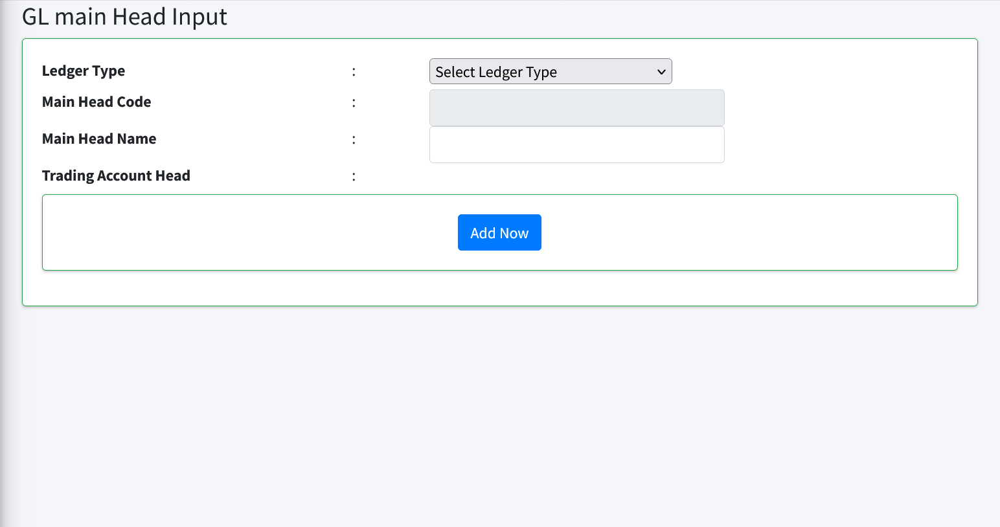
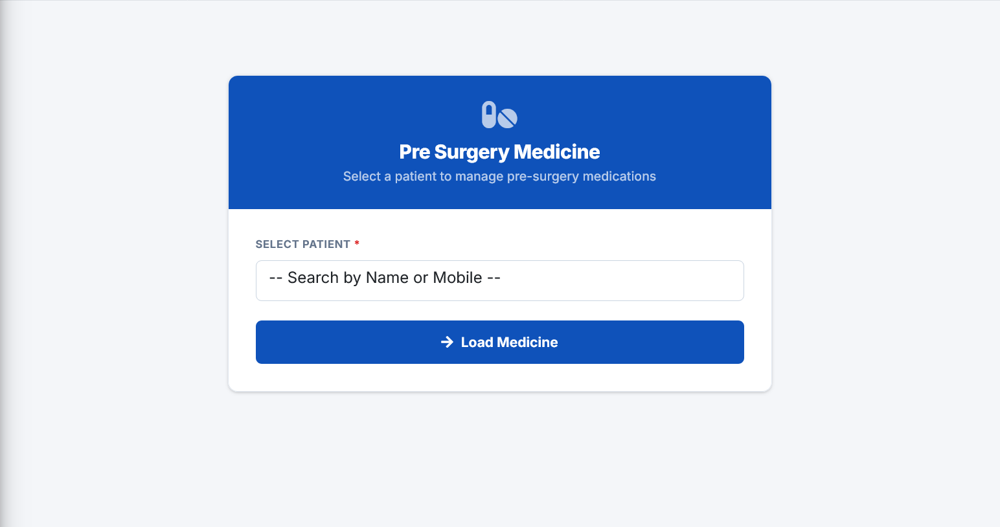
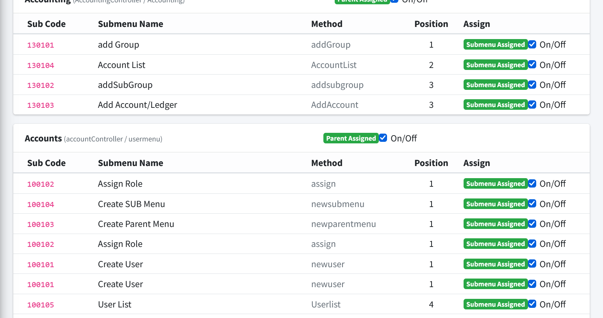
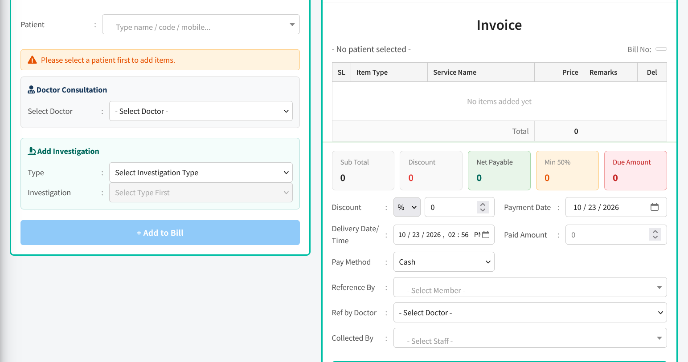

# Professor Clinic — Hospital Management System

<p align="center">
  <strong>A production-focused clinic operations platform for patient care, billing, admissions, and financial control.</strong>
</p>

<p align="center">
  
  
  
  
</p>

Professor Clinic is a full-stack healthcare-management system designed for the day-to-day workflow of a clinic and diagnostic centre. It brings patient registration, clinical admissions, billing, accounting, reports, medicine workflows, and role-aware administration into one operational application.

> **Privacy note:** Public portfolio screenshots use empty or de-identified interfaces only. No patient records, phone numbers, invoices, prescriptions, database exports, or environment credentials are included in this repository.

## Product capabilities

- **Patient lifecycle** — registration, appointments, admissions, beds, discharge flow, and patient audit reporting.
- **Clinical workflows** — pre-/post-surgery medication, prescriptions, investigations, doctors, and printable clinical documents.
- **Billing & collections** — invoices, cash collection, due tracking, discounts, payment history, and investigation reporting.
- **Accounting** — chart of accounts, cash/bank transactions, ledger views, income and expenditure statements, trial balance, and closing workflows.
- **Operational reporting** — revenue by category, daily/monthly reports, PDF/CSV exports, and filtered audit records.
- **Administration** — user management, permissions, configurable menus, masters, settings, and notification flows.

## Interface preview

<p align="center">
  
  
</p>

<p align="center">
  
  
</p>

## Technical profile

| Layer | Stack |
| --- | --- |
| Backend | PHP 8.2+, Laravel 12, Eloquent ORM, Form Requests |
| Frontend | Blade, JavaScript, Vite, AdminLTE |
| Database | MySQL with versioned Laravel migrations |
| Documents | DOMPDF and mPDF for printable reports and receipts |
| Quality | PHPUnit feature/unit tests, Laravel Pint |
| Delivery | GitHub Actions deployment through repository secrets |

## Local setup

**Requirements:** PHP 8.2+, Composer, Node.js, npm, and MySQL.

```bash
git clone https://github.com/Hssazzad/Proffessor--Clinic-Hospital-managment.git
cd Proffessor--Clinic-Hospital-managment
composer install
npm install
```

Create your **own** local environment configuration with database and mail values for your machine. Environment templates and credentials are intentionally kept outside the public repository:

```bash
php artisan key:generate
php artisan migrate
npm run build
php artisan serve
```

## Verification

```bash
php artisan test
./vendor/bin/pint --test
```

## Security and data handling

- Environment files, database exports, backups, generated documents, and temporary diagnostic artifacts are excluded with `.gitignore`.
- Deployment connection details are supplied as GitHub Actions secrets; they are not stored in source control.
- Before a production rollout, use a separate database, rotate any credentials that may have been used locally, and review authorization policies for the target clinic.
- This portfolio repository intentionally excludes real patient data and other confidential operational artifacts.

## Project status

The application is actively maintained and contains production-oriented modules for healthcare operations, clinical documentation, billing, and accounting. Feature behavior and required configuration should be reviewed with the client before deployment to a new clinic.

## License

Private portfolio project. Reuse, deployment, and commercial licensing require the repository owner's written permission.
